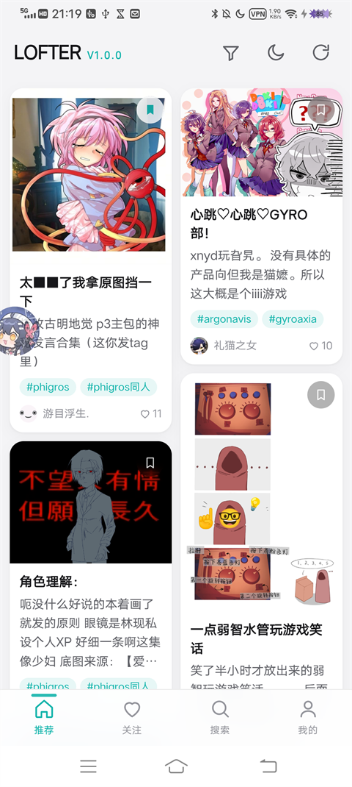
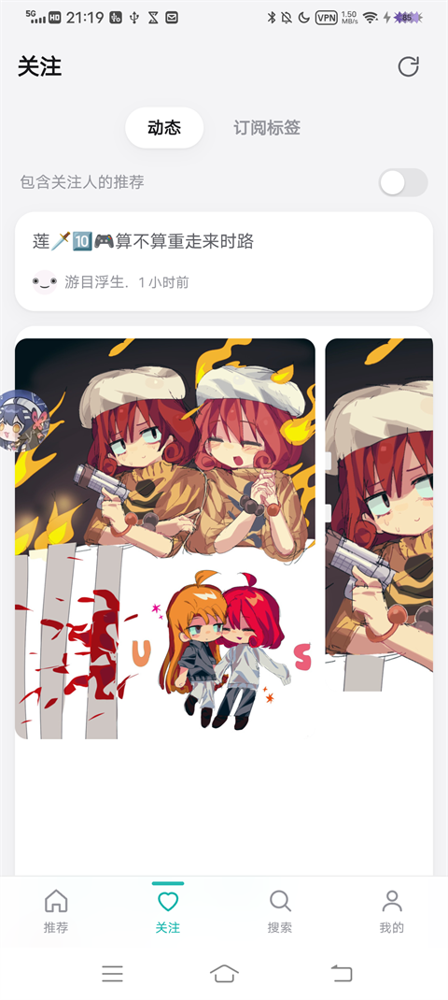
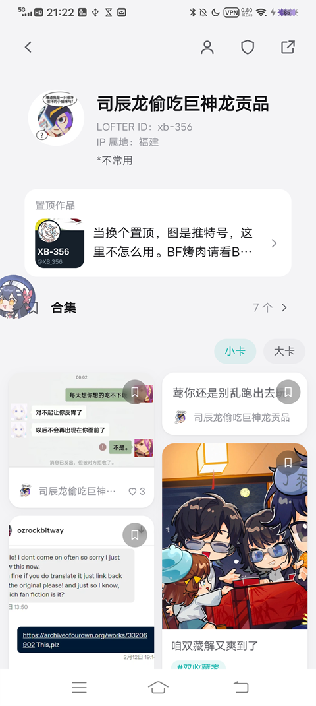

# LOFTER Lite

一个更轻的 LOFTER 客户端：**保留查看推荐、关注动态、订阅标签等基础内容，增强屏蔽**。

打开就是内容，没有广告、没有商城、没有开屏，也没有推送。

> **声明**
>
> 本软件由 **DeepSeek** 代工开发，与 **LOFTER 官方无任何关系**；内容与版权归 LOFTER 及原作者所有，仅用于个人浏览，请勿用于商业用途。

## 下载

到 [Releases](https://github.com/XB-356/lofter-lite/releases/latest) 下载 `lofter-lite.apk` 安装即可（Android 5.0+）。

也可以自己从源码打包，见 [DEVELOP.md](DEVELOP.md)。

## 截图

| 推荐 | 关注 | 我的 |
| --- | --- | --- |
|  |  |  |

| 屏蔽 | 搜索 | 博主主页 |
| --- | --- | --- |
|  |  |  |

## 它能做什么

- **看内容**：推荐流、关注动态、订阅标签（缩略图缓存在本机，进页面立刻有图）
- **看作品**：多图与视频、发布 / 编辑时间、所属合集（可上下篇翻）、评论与楼中楼、图片评论看大图、划线评原文
- **搜内容**：标签、用户、作品
- **自己的账号**：关注 / 粉丝 / 喜欢 / 收藏 / 推荐都能点进去看；可以点赞、关注、评论、分享
- **增强屏蔽**：标签、关键词、某个用户、拉黑名单，都在「我的 → 屏蔽」里统一管；可导入导出备份；能开关「隐藏粮票 / 付费作品」；也可以选择把屏蔽同步到账号
- **其他**：保存图片到相册、复制作品链接直接跳转、返回上一页回到原位置、深色模式

**这里没有**：发布作品（官方未开放第三方发布接口）、私信、会员、广告。

## 用起来

### 手机（APK）

1. 从 [Releases](https://github.com/XB-356/lofter-lite/releases/latest) 下载 APK 安装
2. 登录 LOFTER 账号（登录态只存在本机，随时可在「我的 → 退出登录」清掉）

### 电脑（网页版）

零依赖，Node.js ≥ 20 即可：

```bash
node server.js
# 打开 http://127.0.0.1:8787
```

网页版只读公开内容，不需要登录。

## 你的数据

屏蔽名单、本机收藏、浏览历史、标签缩略图缓存都只存在**这台设备**上，不会上传到任何服务器。仓库里不包含任何账号 Cookie、签名密钥或构建产物。

## 常见问题

- **页面空白 / 加载不出来**：先下拉刷新，多半是上游接口临时抽风。
- **点赞、关注提示「滑动验证」**：LOFTER 的风控，拖对拼图就能继续。
- **我的页 IP 属地哪来的**：LOFTER 没有账号级 IP 字段，显示的是你最近一篇作品的属地。
- **换手机名单还在吗**：名单只在本机，先在「我的 → 屏蔽 → 导入 / 导出」备份，再到新设备导入。

## 开发

源码结构、命令、打包 APK、真机调试都在 [DEVELOP.md](DEVELOP.md)。
