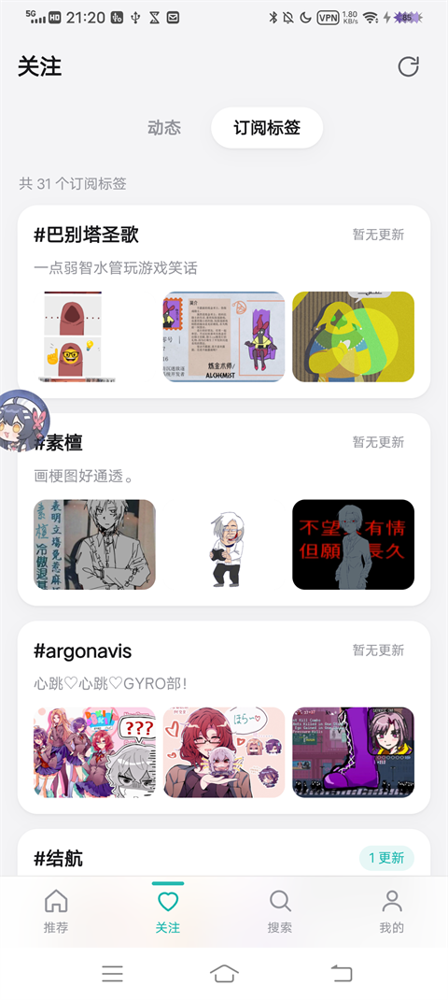
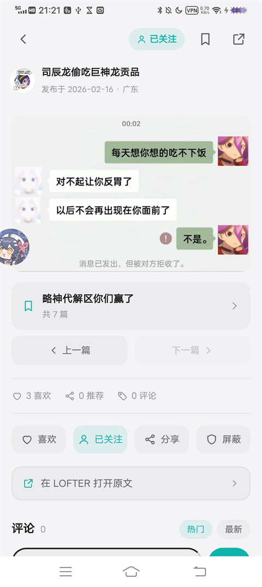
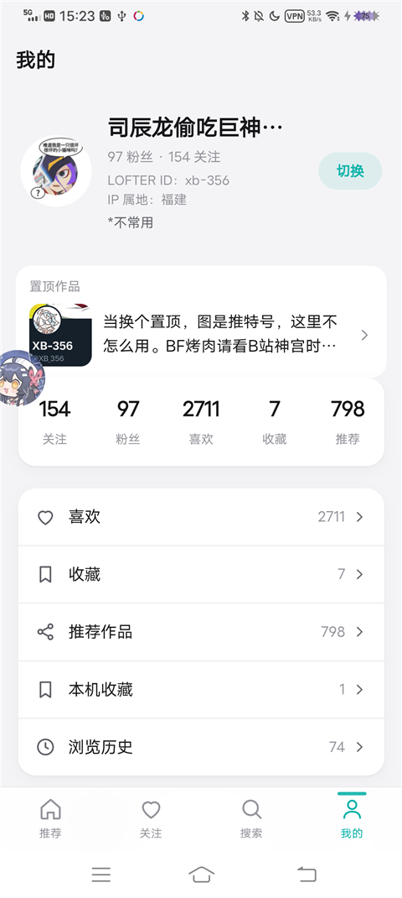
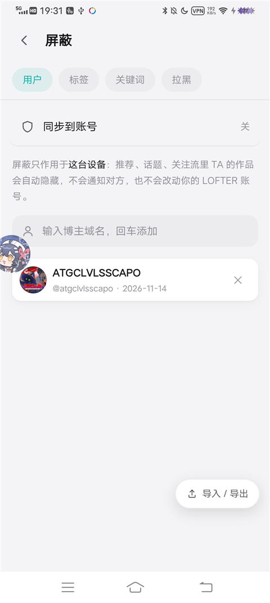
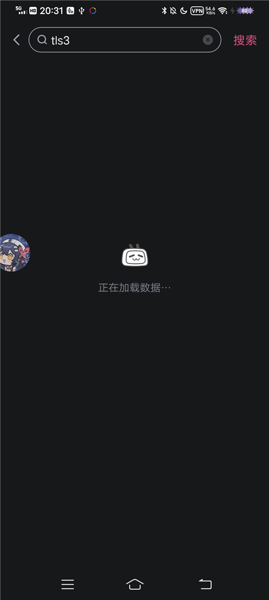

# LOFTER Lite

一个更轻的 LOFTER 客户端：**保留查看推荐、关注动态、订阅标签等基础内容，增强屏蔽**。

打开就是内容，没有广告、没有商城、没有开屏，也没有推送。

> **声明**
>
> 本软件由 **DeepSeek** 代工开发，与 **LOFTER 官方无任何关系**；内容与版权归 LOFTER 及原作者所有，仅用于个人浏览，请勿用于商业用途。

## 下载

到 [Releases](https://github.com/XB-356/lofter-lite/releases/latest) 下载 `lofter-lite.apk` 安装即可（Android 5.0+）。

也可以自己从源码打包，见 [DEVELOP.md](DEVELOP.md)。

## 截图

| 推荐 | 关注 | 订阅标签 | 作品 |
| --- | --- | --- | --- |
|  |  |  |  |

| 我的 | 屏蔽 | 搜索 | 博主主页 |
| --- | --- | --- | --- |
|  |  |  |  |

## 它能做什么

保留查看推荐、关注动态、订阅标签等基础内容，增强屏蔽。

**基础浏览**

- **推荐流**：瀑布流刷新，可按标签筛选
- **关注动态**：动态 / 订阅两栏切换；「包含关注人的推荐」可开关；
- **订阅标签**：每个标签一张大卡片 + 三张缩略图
- **订阅合集**：关注页「订阅 → 订阅合集」，列出订阅的合集，显示作者、作品数与上次更新时间
- **标签订阅**：标签页右上角一键「订阅 / 已订阅」，订阅写在账号上，官方 App 与网页端同步
- **标签榜单与筛选**：话题页「热门」可按总榜 / 月榜 / 周榜 / 日榜切换，还能按内容范围（不限 / 我关注的人 / 没看过的）、内容形式（文字 / 图片）、发布时间（一天 / 一周 / 一个月）筛选
- **作品详情**：多图、视频、发布与编辑时间、所属合集、评论与楼中楼
- **评论**：热门 / 最新切换
- **搜索**：标签、用户、作品三类结果
- **账号页**：关注 / 粉丝 / 喜欢 / 收藏 / 推荐都能点进去看列表；博主主页显示 LOFTER ID、IP 属地、简介与置顶作品
- **阅读体验**：保存图片到相册、复制作品链接自动跳转、深色模式跟随系统

**增强屏蔽（重点）**

- **四种「不想看」**：屏蔽标签、关键词、屏蔽用户、拉黑名单，统一收在「我的 → 屏蔽」一个入口里，进去后顶栏切换
- **屏蔽标签**：推荐、话题、关注流里带这个标签的内容全部隐藏；整个标签都被过滤时给出说明，不留空白页
- **关键词**：标题、摘要、标签命中关键词就隐藏
- **屏蔽用户**：只在这台设备上静默隐藏 TA 的作品，不通知对方、也不改动账号
- **拉黑名单**：账号级黑名单的镜像，可以从账号同步黑名单与标签
- **隐藏粮票 / 付费作品**：设置里一键开关，默认隐藏
- **就地屏蔽**：作品详情页点「屏蔽」可直接屏蔽作者或当前标签；长按卡片只弹屏蔽面板，不会选中文字
- **屏蔽说明卡**：打开被屏蔽的链接时，卡片显示作者、标题、标签与「被什么原因屏蔽」，可以选「继续观看」
- **备份与同步**：名单可导入 / 导出成 JSON；也可以选择把标签屏蔽、拉黑同步到账号（写账号操作，需登录，短时间连续操作可能触发滑块验证）

## 这里没有

发布作品（官方未开放第三方发布接口）、私信、会员、广告。

## 用起来

### 手机（APK）

1. 从 [Releases](https://github.com/XB-356/lofter-lite/releases/latest) 下载 APK 安装
2. 登录 LOFTER 账号（登录态只存在本机，随时可在「我的 → 退出登录」清掉）

### 电脑（网页版）

零依赖，Node.js ≥ 20 即可：

```bash
node server.js
# 打开 http://127.0.0.1:8787
```

网页版只读公开内容，不需要登录。

## 你的数据

屏蔽名单、本机收藏、浏览历史、标签缩略图缓存都只存在**这台设备**上，不会上传到任何服务器。仓库里不包含任何账号 Cookie、签名密钥或构建产物。

## 常见问题

- **页面空白 / 加载不出来**：先下拉刷新，多半是上游接口临时抽风。
- **点赞、关注提示「滑动验证」**：LOFTER 的风控，拖对拼图就能继续。
- **我的页 IP 属地哪来的**：LOFTER 没有账号级 IP 字段，显示的是你最近一篇作品的属地。
- **换手机名单还在吗**：名单只在本机，先在「我的 → 屏蔽 → 导入 / 导出」备份，再到新设备导入。

## 开发

源码结构、命令、打包 APK、真机调试都在 [DEVELOP.md](DEVELOP.md)。
